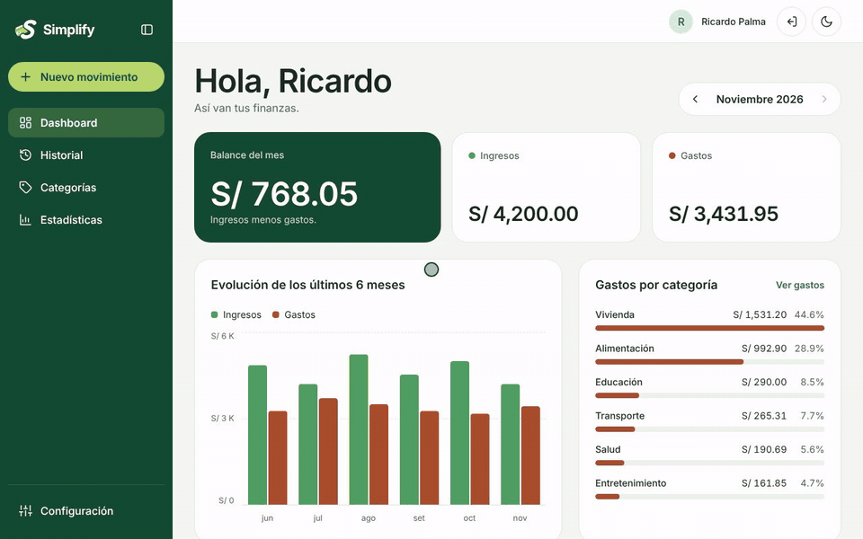
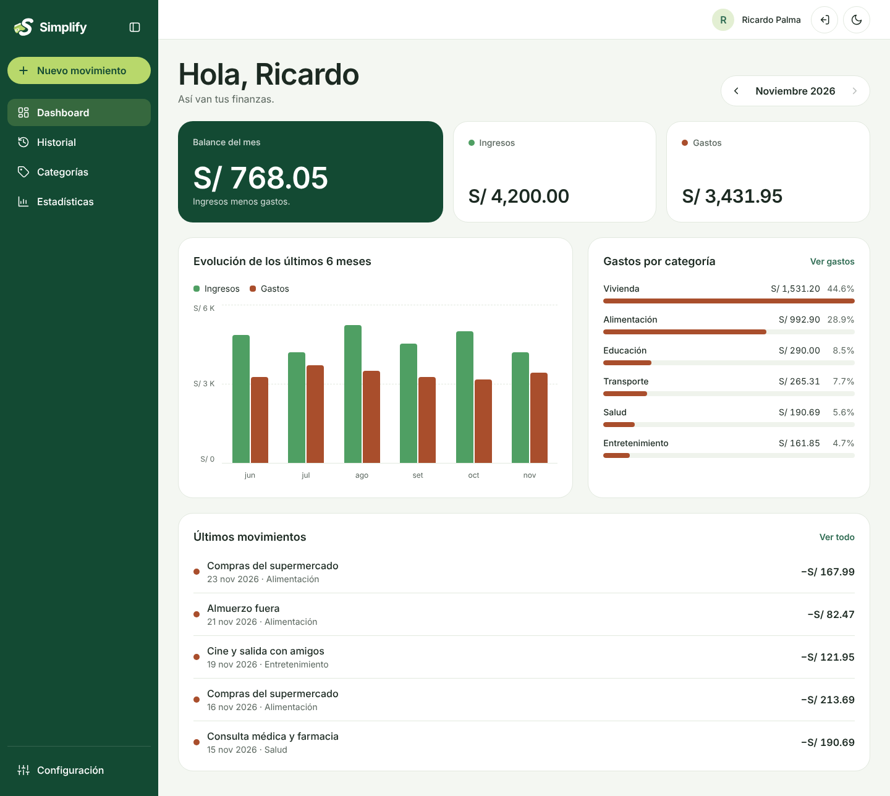
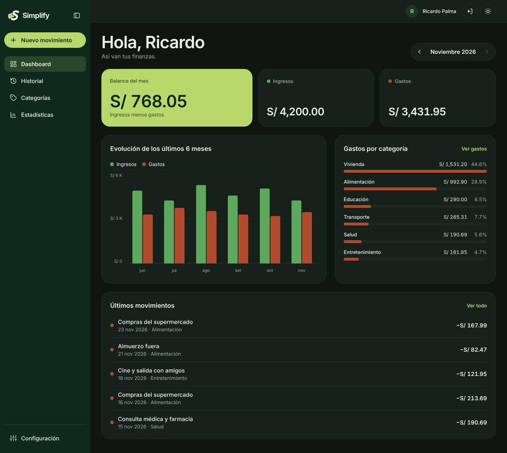
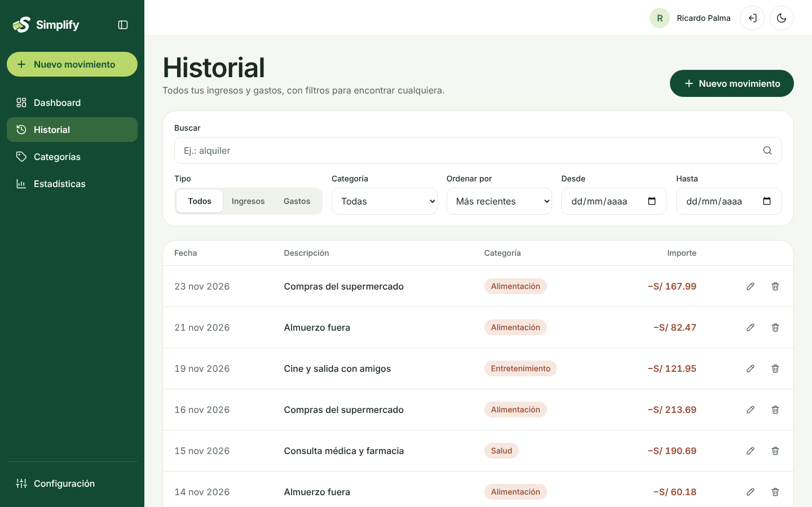
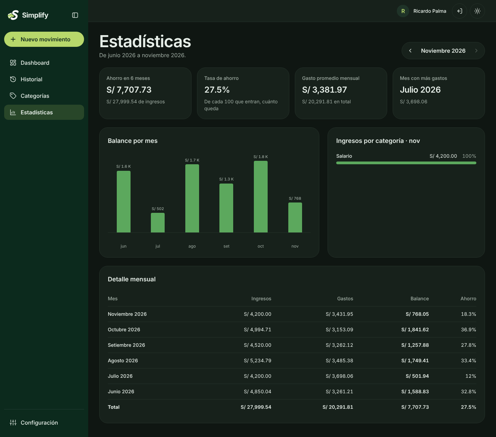
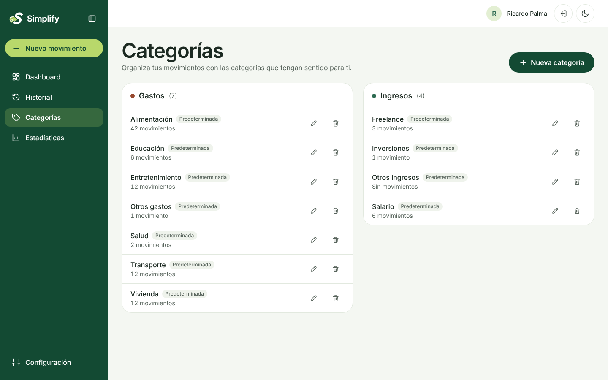
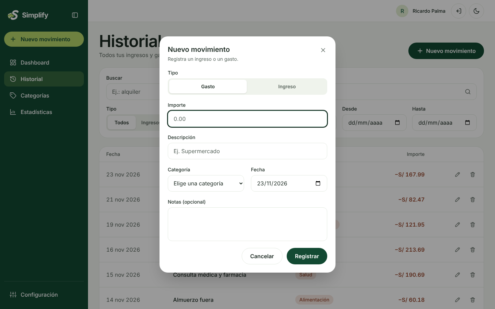
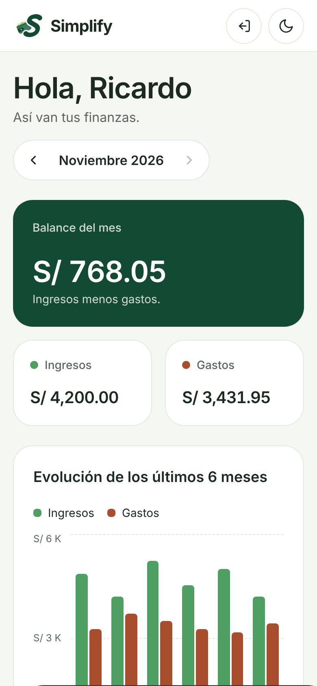
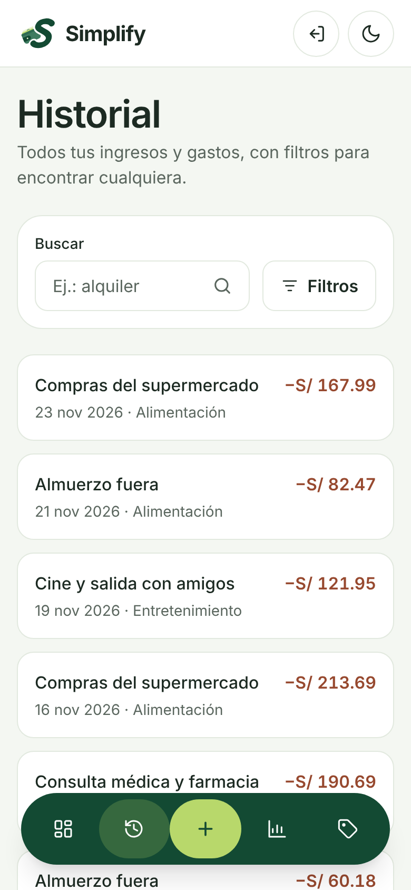
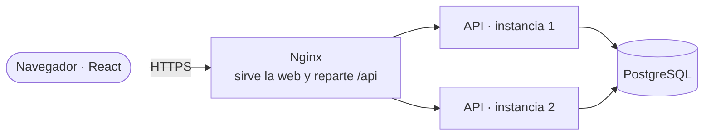

# 💰 Simplify


Aplicación web full stack de finanzas personales para registrar, organizar y analizar ingresos y gastos. Calcula el balance de cada mes y muestra en qué categorías se usa el dinero. Es un proyecto de portafolio para practicar diseño de sistemas, lógica de negocio, manejo preciso de dinero, seguridad, pruebas automatizadas y escalabilidad.



## 📸 Capturas

| Dashboard                                                                  | Dashboard en tema oscuro                                                             |
| -------------------------------------------------------------------------- | ------------------------------------------------------------------------------------ |
|      |                       |
| **Historial con filtros**                                                  | **Estadísticas**                                                                     |
|  |      |
| **Categorías**                                                             | **Nuevo movimiento**                                                                 |
|      |  |

<p align="center">
  
  &nbsp;&nbsp;
  
</p>

Las capturas usan una cuenta de demostración con seis meses de datos. Para tenerla en tu copia: `npm run demo:datos` (ver [Cómo ejecutarlo](#-cómo-ejecutarlo)).

## 📦 Tecnologías

- **Frontend:** React, TypeScript, Vite, React Router, TanStack Query, Tailwind CSS (formularios y gráficos hechos a mano, sin librerías)
- **Backend:** Node.js, Express, Prisma, PostgreSQL
- **Validación:** Zod (el mismo esquema en frontend y backend)
- **Pruebas:** Vitest, React Testing Library, Supertest, Playwright (con axe-core para accesibilidad), k6
- **Infraestructura:** Docker, Nginx (balanceo de carga), GitHub Actions (CI)

## ✨ Funcionalidades

- **Crear una cuenta** con una contraseña segura (mínimo 8 caracteres, con mayúscula, minúscula, número y carácter especial).
- **Iniciar y cerrar sesión**, con la sesión guardada en cookies protegidas y límite de intentos.
- **Registrar ingresos y gastos** con descripción, importe, categoría, fecha y notas. El importe siempre es positivo: la app decide si suma o resta según el tipo.
- **Editar o eliminar** cualquier movimiento, con confirmación antes de borrar.
- **Organizar en categorías** propias o predeterminadas. Al eliminar una categoría con movimientos, la app pide a cuál pasarlos.
- **Consultar el historial** con filtros por periodo, tipo y categoría, búsqueda por descripción, orden por fecha o importe y paginación. Los filtros quedan en la dirección de la página: se pueden guardar o compartir.
- **Ver el balance del mes** en un dashboard: ingresos, gastos, evolución de los últimos 6 meses, gastos por categoría y últimos movimientos. Se puede navegar a meses anteriores.
- **Analizar las estadísticas** de los últimos 6 meses: ahorro, tasa de ahorro, gasto promedio, mes con más gastos y detalle mensual.
- **Elegir la moneda principal** (USD, PEN, EUR, MXN o COP) y cambiar el nombre.
- **Elegir el tema claro u oscuro.** Se recuerda la elección y, si no hay una, se usa la del sistema.
- **Usarla en el teléfono**, con barra de navegación inferior y el historial en tarjetas.
- **Ver pantallas de carga, vacío y error** (incluida la página 404 y el aviso sin conexión).

## ⌨️ Atajos de teclado

Todavía no hay atajos propios, pero toda la app se puede usar con el teclado: `Tab` recorre los elementos y el foco siempre es visible.

## 🏗️ Arquitectura



Nginx sirve la web y reparte las peticiones de la API entre varias instancias de Express, que comparten una base de datos PostgreSQL. Las instancias no guardan nada en memoria, así cualquiera puede atender cualquier petición. Los detalles (capas de la API, modelo de datos y decisiones técnicas) están en [`docs/arquitectura.md`](docs/arquitectura.md).

```
apps/web         Interfaz en React
apps/api         API en Express + Prisma
packages/shared  Esquemas y reglas que usan ambos
docs             Arquitectura, modelo de datos, contrato OpenAPI y decisiones técnicas (ADR)
```

## 🧑‍🍳 El proceso

1. Definí los requisitos, las reglas de negocio y el alcance antes de escribir código.
2. Diseñé la interfaz: minimalista, en verde bosque y lima, con menú lateral desplegable y tema oscuro.
3. Armé un monorepo con `npm workspaces`: `apps/web`, `apps/api` y `packages/shared`.
4. Construí la base del backend por capas (rutas, controladores, servicios y repositorio) con Prisma sobre PostgreSQL.
5. Modelé los datos para que la propia base de datos impida errores: un gasto no puede usar una categoría de ingreso y una categoría con movimientos no se puede borrar.
6. Configuré la calidad desde el inicio: ESLint, Prettier, pruebas automatizadas y un CI que corre en cada Pull Request.
7. Implementé la autenticación: contraseñas con Argon2id, sesión en cookies httpOnly con un token de acceso de 15 minutos y uno de renovación que rota en cada uso, protección CSRF y límite de intentos de inicio de sesión guardado en PostgreSQL.
8. Construí la API de categorías, movimientos y resúmenes: historial con filtros y paginación estable, reasignación de movimientos en una transacción al eliminar una categoría, y balances calculados en PostgreSQL.
9. Construí las pantallas una por una (acceso, historial, categorías, dashboard, estadísticas y configuración), cada una con sus pruebas de componentes y revisando el diseño en escritorio, teléfono y tema oscuro.
10. Agregué pruebas de extremo a extremo con Playwright, que usan la app real en un navegador y analizan la accesibilidad con axe-core. Encontraron errores que las pruebas unitarias no veían.
11. Preparé la infraestructura de producción: imágenes Docker, Nginx repartiendo la carga entre dos instancias de la API y pruebas de carga con k6, todo verificado en el CI.

## 📚 Lo que aprendí

- A no usar `number` para el dinero: los importes viajan como texto y se guardan como `NUMERIC(12,2)`, porque `0.1 + 0.2` no da `0.3` en JavaScript.
- A hacer cumplir las reglas de negocio también en la base de datos, no solo en el código.
- A diseñar para varias instancias desde el principio: nada de sesiones ni contadores en memoria.
- A no guardar secretos en claro: de los tokens de renovación y de los intentos de inicio de sesión solo se guarda un hash.
- A no revelar qué correos están registrados: el inicio de sesión responde igual, y tarda lo mismo, si el correo no existe o si la contraseña es incorrecta.
- A hacer cuentas de dinero en céntimos con `bigint` (enteros exactos) cuando hay que sumar o restar en el código, y a dejar las sumas grandes a la base de datos.
- A que un recurso de otro usuario responda 404 y no 403: así la API no confirma que existe.
- Que las pruebas de extremo a extremo encuentran lo que las demás no ven: un color con poco contraste, un texto que el lector de pantalla anunciaba distinto a como se veía y una pantalla que se desbordaba en el teléfono.
- A medir antes de afirmar: con k6 comprobé que apagar una instancia de la API no produce errores, porque Nginx reintenta en la otra.
- Que una imagen Docker puede cargar cientos de megas que no usa: las dependencias de producción de la API bajaron de 347 MB a 102 MB.

## 💡 Cómo se podría mejorar

- Conectar cuentas bancarias para importar movimientos automáticamente.
- Varias monedas por usuario con conversión según el tipo de cambio.
- Presupuestos mensuales por categoría con alertas.
- Exportar el historial a CSV o Excel.
- Desplegarla en un servidor con HTTPS y un dominio propio.

## 🚀 Cómo ejecutarlo

Necesitas Node.js 24 (o 22.22 o superior), npm, Git y Docker Desktop.

```bash
git clone https://github.com/RicardoPR2107/Simplify.git
cd Simplify
npm install
```

1. Copia `apps/api/.env.example` como `apps/api/.env` (en PowerShell: `Copy-Item apps/api/.env.example apps/api/.env`) y cambia `JWT_SECRET` por una clave propia:

   ```bash
   node -e "console.log(require('crypto').randomBytes(48).toString('hex'))"
   ```

2. Levanta PostgreSQL en Docker (desarrollo en el puerto 5434 y pruebas en el 5433):

   ```bash
   npm run db:up
   ```

3. Crea las tablas:

   ```bash
   npm run db:migrate -w @simplify/api
   ```

4. Arranca la app:

   ```bash
   npm run dev
   ```

5. Abre http://localhost:5173. La API responde en http://localhost:4000/api/v1/health/ready.

### Modo producción (Docker + Nginx)

La app completa en contenedores: Nginx sirve la web y reparte la API entre dos instancias.

```bash
cp .env.example .env   # en PowerShell: Copy-Item .env.example .env; luego completa las dos claves
npm run prod:up        # construye y levanta todo
```

Abre http://localhost:8080. Para tener datos de ejemplo, `npm run demo:datos` crea una cuenta de demostración con seis meses de movimientos (`demo@simplify.app` / `Demo#Simplify2026`). Detalles, comandos y cómo ver el balanceo en [`docs/infraestructura.md`](docs/infraestructura.md).

### Pruebas

```bash
npm test             # unitarias, API, componentes e integración con PostgreSQL
npm run test:e2e     # de extremo a extremo en un navegador real, con análisis de accesibilidad
npm run lint         # análisis estático
npm run typecheck    # revisión de tipos
```

La primera vez, `npm run test:e2e` necesita el navegador de Playwright: `npx playwright install chromium`.

## 📈 Pruebas de carga y escalabilidad

Con [k6](https://k6.io) se simulan personas usando la app a la vez, contra el modo producción (Nginx + 2 instancias de la API + PostgreSQL). Cada usuario virtual abre el dashboard, revisa el historial y a veces registra un gasto.

```bash
npm run load:humo     # 1 usuario, 30 s: comprobación rápida
npm run load:carga    # 30 usuarios simultáneos durante 1 minuto
npm run load:estres   # sube hasta 100 usuarios
```

La prueba falla si más del 1 % de las peticiones da error o si el 95 % no responde en menos de 500 ms.

**Resultados** (perfil `carga`: 30 usuarios simultáneos durante 2 min 17 s, con todo el stack en Docker Desktop sobre Windows en una sola PC)

| Métrica                              | Resultado                | Criterio |
| ------------------------------------ | ------------------------ | -------- |
| Peticiones atendidas                 | 4 195 (≈ 30 por segundo) | —        |
| Peticiones con error                 | 0 %                      | < 1 %    |
| Tiempo de respuesta típico (mediana) | 24 ms                    | —        |
| p95 de todas las peticiones          | 127 ms                   | < 500 ms |
| p95 de lecturas                      | 112 ms                   | < 400 ms |
| p95 de escrituras                    | 171 ms                   | < 600 ms |
| Comprobaciones correctas             | 100 % (4 940 de 4 940)   | > 99 %   |

_p95: el 95 % de las peticiones respondió en ese tiempo o menos._

**Tolerancia a fallos:** durante la prueba de carga se apagó una de las dos instancias de la API. Nginx reintentó en la otra las peticiones que había enviado a la instancia caída, y la prueba terminó sin errores.

## 📄 Derechos

© Ricardo Palma. Todos los derechos reservados.
