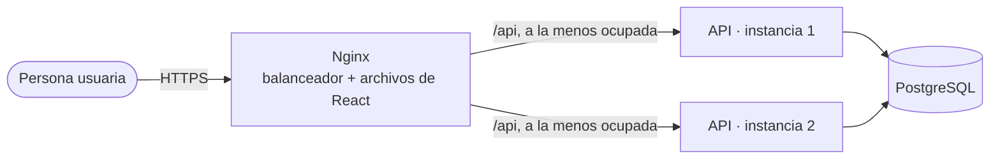
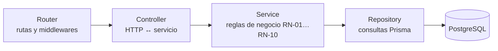

# Arquitectura de Simplify

Simplify es una aplicación web de tres capas: un frontend en React que se ejecuta en el navegador, una API REST en Express que contiene toda la lógica de negocio y una base de datos PostgreSQL. En producción, Nginx reparte el tráfico entre varias instancias idénticas de la API.

## Vista general



- **Nginx** sirve los archivos compilados de React y reenvía `/api` a la instancia de la API con menos conexiones abiertas (`least_conn`). Si una instancia falla (no responde, 502 o 503), la petición se reintenta en otra y la instancia queda apartada unos segundos. Ver [ADR 0005](adr/0005-balanceo-nginx.md) y [`infraestructura.md`](infraestructura.md).
- **Las instancias de la API son stateless**: no guardan sesiones ni contadores en memoria. Todo el estado compartido (tokens de renovación, intentos de login) vive en PostgreSQL. Por eso cualquier instancia puede atender cualquier petición. Ver [ADR 0004](adr/0004-limite-intentos-sin-redis.md).
- **En desarrollo** no hay Nginx: Vite (puerto 5173) reenvía `/api` a una sola API (puerto 4000).

## Estructura del monorepo

```
Simplify/
├── apps/
│   ├── api/          API REST (Node.js + Express + TypeScript + Prisma)
│   └── web/          Frontend (React + TypeScript + Vite + Tailwind)
├── packages/
│   └── shared/       Esquemas Zod, tipos y códigos de error usados por ambos
├── docs/             Arquitectura, modelo de datos, ADRs y contrato OpenAPI
└── docker-compose.yml
```

El paquete `shared` es la razón principal del monorepo: el formulario de React y el endpoint de Express validan con **el mismo esquema**, así que no pueden desincronizarse. Ver [ADR 0001](adr/0001-monorepo.md).

## Capas de la API

Cada módulo (`auth`, `categories`, `movements`, `summary`) sigue la misma cadena:



| Capa       | Responsabilidad                                                  | No hace                    |
| ---------- | ---------------------------------------------------------------- | -------------------------- |
| Router     | Declara rutas y encadena middlewares (autenticación, validación) | Lógica                     |
| Controller | Lee la petición validada, llama al servicio, arma la respuesta   | Acceder a la base de datos |
| Service    | Aplica reglas de negocio y lanza `AppError` cuando se incumplen  | Conocer Express            |
| Repository | Única capa que usa Prisma; **siempre filtra por `userId`**       | Decidir reglas             |

Las dependencias se conectan en un solo lugar, `src/container.ts` (inyección de dependencias manual). En las pruebas se sustituyen por dobles.

### Cadena de middlewares

`helmet` → `cors` → `pino-http` (id de petición) → `express.json` (límite 100 kb) → `cookie-parser` → rutas → `notFoundHandler` → `errorHandler`.

Toda respuesta de error tiene la misma forma:

```json
{
  "error": {
    "code": "VALIDATION_ERROR",
    "message": "…",
    "requestId": "…",
    "fields": { "amount": ["…"] }
  }
}
```

## Frontend

- **Rutas con carga perezosa**: cada página es un chunk aparte (`React.lazy`) y se muestra un skeleton mientras se descarga.
- **Estados de interfaz**: skeletons de carga, `ErrorBoundary` por sección con "Reintentar", página de error de ruta, 404, estados vacíos y aviso sin conexión.
- **Datos remotos**: TanStack Query cachea las respuestas y las invalida al crear, editar o eliminar un movimiento (RN-06).
- **Tema**: tokens de color como variables CSS; la clase `.dark` en `<html>` cambia toda la paleta.
