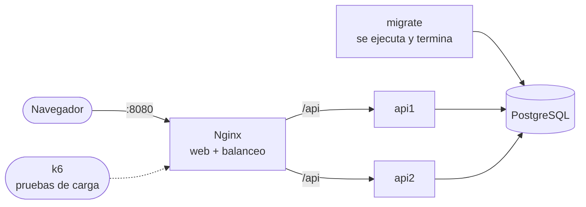

# Infraestructura de Simplify

Cómo se ejecuta Simplify en modo producción: imágenes Docker, balanceo de carga con Nginx y pruebas de carga con k6. Todo corre en una sola máquina con Docker Compose, igual que se haría en un servidor.

## Vista general



| Servicio  | Imagen                   | Qué hace                                                                  |
| --------- | ------------------------ | ------------------------------------------------------------------------- |
| `db`      | `postgres:17-alpine`     | Base de datos. Sin puertos publicados: solo la ven los demás contenedores |
| `migrate` | `simplify-migrate:local` | Aplica las migraciones pendientes y termina                               |
| `api1`    | `simplify-api:local`     | Instancia 1 de la API                                                     |
| `api2`    | `simplify-api:local`     | Instancia 2 de la API (misma imagen)                                      |
| `nginx`   | `simplify-web:local`     | Sirve el frontend y reparte `/api` entre `api1` y `api2`                  |
| `k6`      | `grafana/k6:1.4.2`       | Pruebas de carga. Solo se ejecuta a pedido (perfil `load`)                |

El orden de arranque lo controla Compose: `db` sano → `migrate` termina bien → `api1` y `api2` sanas → `nginx`.

## Imágenes

Las dos imágenes se construyen desde la raíz del repositorio con **builds de varias etapas** (multi-stage): una etapa instala todo y compila, y la imagen final solo copia el resultado. Así no viajan a producción el compilador de TypeScript, las herramientas de pruebas ni el código fuente.

**API** (`apps/api/Dockerfile`)

- `build`: instala dependencias, compila el paquete compartido, genera el cliente de Prisma y compila la API.
- `migrate`: parte de `build` porque necesita la CLI de Prisma; ejecuta `prisma migrate deploy`.
- `runtime`: solo dependencias de producción y `dist/`. [`infra/prune-dev-deps.mjs`](../infra/prune-dev-deps.mjs) elimina además los paquetes que npm deja instalados aunque solo sirven en desarrollo (la CLI de Prisma con Prisma Studio, TypeScript…): `node_modules` pasa de 347 MB a 102 MB.
- Corre como el usuario `node` (no root) y con el sistema de archivos en solo lectura (`read_only: true`).

**Web** (`apps/web/Dockerfile`)

- `build`: compila el frontend con Vite.
- `runtime`: `nginx:stable-alpine` con los archivos compilados y la configuración de [`infra/nginx/`](../infra/nginx/).

`.dockerignore` evita enviar a Docker `node_modules`, compilados, archivos `.env` e historial de git.

## Nginx

Configuración en [`infra/nginx/nginx.conf`](../infra/nginx/nginx.conf). Las decisiones del balanceo están en el [ADR 0005](adr/0005-balanceo-nginx.md).

| Qué             | Cómo                                                                                            |
| --------------- | ----------------------------------------------------------------------------------------------- |
| Balanceo        | `least_conn`: cada petición va a la instancia con menos conexiones abiertas                     |
| Instancia caída | Reintenta en la otra; tras 3 fallos la aparta 10 s (`max_fails`, `fail_timeout`)                |
| Fuerza bruta    | `/api/v1/auth/` limitado a 5 peticiones por segundo por IP (ráfagas de 10), responde 429        |
| Trazabilidad    | Envía `X-Request-Id` a la API: el mismo id aparece en el log de Nginx y en el de la API         |
| Rutas de React  | Cualquier ruta desconocida devuelve `index.html` (React Router decide qué mostrar)              |
| Caché           | `/assets/*` (con hash en el nombre) un año; `index.html` nunca, para que cada versión llegue ya |
| Compresión      | gzip para HTML, CSS, JS, JSON y SVG                                                             |
| Cabeceras       | CSP estricta, `X-Frame-Options`, `nosniff`, `Referrer-Policy`, `Permissions-Policy`             |

La **CSP** (Content Security Policy) solo permite scripts del mismo sitio. Por eso el script que aplica el tema oscuro antes de pintar vive en `apps/web/public/theme-init.js` y no dentro del HTML.

El log de acceso muestra qué instancia atendió cada petición:

```
172.18.0.1 "GET /api/v1/summary/month?year=2026&month=11 HTTP/1.1" 200 0.004s upstream=172.18.0.4:4000 ...
```

## Cómo ejecutarlo

Necesitas Docker Desktop.

1. Crea el archivo `.env` en la raíz del repositorio (en PowerShell: `Copy-Item .env.example .env`) y completa las dos claves. Para generarlas:

   ```bash
   node -e "console.log(require('crypto').randomBytes(32).toString('hex'))"
   ```

   Usa una clave distinta para cada variable. Solo letras y números: la contraseña de PostgreSQL va dentro de una URL.

2. Construye y levanta todo (la primera vez tarda unos minutos):

   ```bash
   npm run prod:up
   ```

3. Abre http://localhost:8080.

| Comando              | Qué hace                                                |
| -------------------- | ------------------------------------------------------- |
| `npm run prod:up`    | Construye las imágenes y levanta el stack               |
| `npm run prod:ps`    | Estado y salud de cada contenedor                       |
| `npm run prod:logs`  | Logs de Nginx y de las dos APIs en vivo                 |
| `npm run prod:down`  | Apaga todo (los datos se conservan en un volumen)       |
| `npm run demo:datos` | Crea una cuenta de demostración con seis meses de datos |

> Las cookies de sesión son `Secure` (solo viajan por HTTPS). Los navegadores hacen una excepción con `localhost`, por eso funciona en http://localhost:8080 pero no desde otra máquina por su IP. En un servidor real, Nginx se configuraría con un certificado HTTPS.

### Ver el balanceo y la tolerancia a fallos

Con la app abierta, en otra terminal:

```bash
npm run prod:logs                                   # cada línea dice upstream=... (api1 o api2)
docker compose -f docker-compose.prod.yml stop api1 # apaga una instancia: la app sigue funcionando
docker compose -f docker-compose.prod.yml start api1
```

## Pruebas de carga (k6)

Script en [`load-tests/load.js`](../load-tests/load.js). Simula personas que abren el dashboard (cuatro peticiones a la vez, como el navegador), revisan el historial y, una de cada cinco veces, registran un gasto. Antes de empezar crea 20 cuentas con algunos movimientos.

| Perfil   | Comando               | Usuarios simultáneos          | Para qué                                   |
| -------- | --------------------- | ----------------------------- | ------------------------------------------ |
| `humo`   | `npm run load:humo`   | 1 durante 30 s                | Comprobar que el script y la app funcionan |
| `carga`  | `npm run load:carga`  | Sube a 30 y se mantiene 1 min | Uso normal con varias personas a la vez    |
| `estres` | `npm run load:estres` | Sube hasta 100                | Ver dónde empieza a degradarse             |

**Criterios de aceptación** (si no se cumplen, k6 termina con error):

- Menos del 1 % de peticiones con error.
- El 95 % de las peticiones (p95) responde en menos de 500 ms; lecturas en menos de 400 ms y escrituras en menos de 600 ms.
- Más del 99 % de las comprobaciones (`checks`) correctas.

Para medir la tolerancia a fallos, lanza `npm run load:carga` y, mientras corre, apaga y vuelve a encender `api1` con los comandos de la sección anterior.

## En CI

El job **Stack de producción** de GitHub Actions construye las imágenes, levanta el stack completo y ejecuta k6 con el perfil `humo`. Si una imagen no compila, una migración falla o la API no responde detrás de Nginx, el PR queda en rojo.
