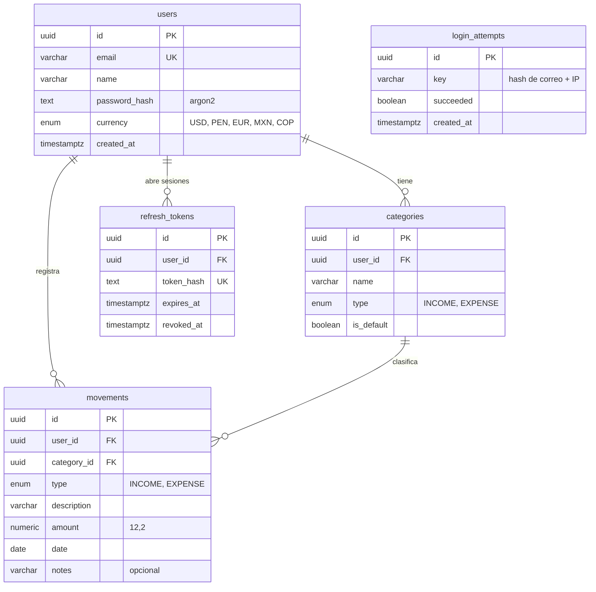

# Modelo de datos

Fuente de verdad: [`apps/api/prisma/schema.prisma`](../apps/api/prisma/schema.prisma).

## Cómo el modelo hace cumplir las reglas de negocio

| Regla                        | Dónde se garantiza                                                                                                                                        |
| ---------------------------- | --------------------------------------------------------------------------------------------------------------------------------------------------------- |
| RN-01 Importe mayor que cero | Esquema Zod `amountSchema` + `CHECK (amount > 0)` en la migración                                                                                         |
| RN-02 Solo ingreso o gasto   | Enum `MovementType`                                                                                                                                       |
| RN-03 Categoría compatible   | Clave foránea compuesta `(category_id, type) → categories(id, type)`: la base de datos rechaza un gasto con categoría de ingreso aunque el código fallara |
| RN-05 Aislamiento            | Toda tabla de negocio tiene `user_id`; los repositorios siempre filtran por él                                                                            |
| RN-07 Una moneda por usuario | `currency` vive en `users`, no en cada movimiento                                                                                                         |
| RN-08 Fechas                 | `date` es de tipo `DATE` (sin hora ni zona horaria): "noviembre" es siempre del 1 al 30                                                                   |
| RN-09 Categoría en uso       | `ON DELETE RESTRICT` en `movements.category_id`                                                                                                           |
| 5.3 Precisión                | `NUMERIC(12,2)`: hasta 9 999 999 999.99 sin errores de redondeo                                                                                           |

## Índices

- `movements (user_id, date)`: historial y resúmenes por mes.
- `movements (user_id, type, date)`: totales de ingresos o gastos de un periodo.
- `movements (user_id, category_id)`: gastos por categoría y comprobación antes de eliminar una categoría.
- `login_attempts (key, created_at)`: contar intentos recientes rápidamente.

> La restricción `CHECK (amount > 0)` no se puede declarar en Prisma; se añade a mano en la primera migración (Fase 1).
